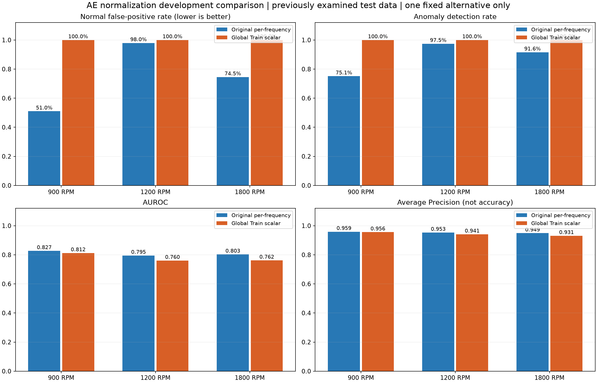

# AE 정규화 방식 개발용 비교

후속 결정: 공통 정규화 비교안은 채택하지 않고 기존 주파수별 Train 정규화를 유지합니다.
이 문서의 비교 수치와 두 실험 결과는 변경 없이 보존하며 저장 모델 단일 추론은 기존 실험을 사용합니다.

이미 점수·원본을 분석한 9/19 시험 데이터를 재사용하는 **개발용 비교**입니다. 독립적인 최종 성능 검증이나 정규화 방식의 최종 선정 결과가 아닙니다.
AE만 각 RPM에서 한 번씩 추가 학습했습니다. OCSVM·IF·DAE는 재실행하지 않았고 결과를 보고 추가 설정 탐색을 하지 않았습니다.

## 변경한 요소와 유지한 조건

- 기존: 9/12 Train의 주파수별 평균·표준편차 `(1,1,3201)`.
- 비교: 해당 RPM의 9/12 CH3 Train log1p 스펙트럼 모든 값에서 계산한 공통 평균·표준편차 `(1,1,1)`, ddof=0.
- 9/12 학습·9/16 검증·9/19 시험, 품질 제외·Normal3 제외·파일 목록을 그대로 유지했습니다.
- FFT·log1p NPZ와 split CSV를 바이트 동일하게 복사했고 원본 MAT는 다시 처리하지 않았습니다.
- AE 구조·seed 42·batch 32·Adam 0.001·최대30 epoch·patience8·검증 기준 모델 선택을 유지했습니다.
- 파일 점수는 8개 구간 MSE 평균입니다. 변경 모델은 새 검증 구간/파일 점수에서 각각 Q95를 계산했습니다.
- σ 하한 1e-6도 유지했습니다. 실제 Run ID는 미확정이며 날짜 그룹 표기를 유지했습니다.

## 파일 단위 전체 지표

| RPM | 정규화 | 정상 오탐률 | 이상 탐지율 | AUROC | AP | FP | FN |
| --- | --- | ---: | ---: | ---: | ---: | ---: | ---: |
| 900 | per_frequency | 51.00% | 75.13% | 0.8270 | 0.9590 | 51 | 99 |
| 900 | global_train | 100.00% | 100.00% | 0.8122 | 0.9558 | 100 | 0 |
| 1200 | per_frequency | 97.98% | 97.46% | 0.7950 | 0.9531 | 97 | 10 |
| 1200 | global_train | 100.00% | 100.00% | 0.7604 | 0.9410 | 99 | 0 |
| 1800 | per_frequency | 74.51% | 91.58% | 0.8031 | 0.9488 | 76 | 33 |
| 1800 | global_train | 100.00% | 100.00% | 0.7618 | 0.9308 | 102 | 0 |

공통 정규화 모델은 시험 정상 301개와 결함 1,183개를 모두 이상으로 판정했습니다.
따라서 탐지율 100%를 정상·이상 구분의 개선으로 해석할 수 없습니다.
이번 실험에서 정상 오탐률은 개선되지 않았고 AUROC·AP도 세 RPM 모두 기존보다 낮았습니다.
이 특정 비교안으로 날짜 간 오탐 문제를 해결하지 못했다는 개발 결과이며,
이를 근거로 추가 정규화·모델 설정 탐색이나 임계값 조정은 하지 않았습니다.

## 상태별 파일 판정 비율

각 셀은 기존 주파수별 → 공통 정규화입니다. Normal1·Normal2는 **오탐률**, 나머지 결함은 **탐지율**입니다.

| 상태 | 900RPM | 1200RPM | 1800RPM |
| --- | ---: | ---: | ---: |
| IR | 100.00% → 100.00% | 100.00% → 100.00% | 100.00% → 100.00% |
| Looseness0.05 | 100.00% → 100.00% | 100.00% → 100.00% | 88.46% → 100.00% |
| Looseness0.1 | 100.00% → 100.00% | 100.00% → 100.00% | 100.00% → 100.00% |
| LoosenessFull | 100.00% → 100.00% | 100.00% → 100.00% | 100.00% → 100.00% |
| Normal1 | 0.00% → 100.00% | 95.92% → 100.00% | 48.00% → 100.00% |
| Normal2 | 100.00% → 100.00% | 100.00% → 100.00% | 100.00% → 100.00% |
| OR | 100.00% → 100.00% | 100.00% → 100.00% | 100.00% → 100.00% |
| Roller | 100.00% → 100.00% | 100.00% → 100.00% | 100.00% → 100.00% |
| Unbalance_-1 | 0.00% → 100.00% | 100.00% → 100.00% | 43.75% → 100.00% |
| Unbalance_-2 | 2.00% → 100.00% | 79.17% → 100.00% | 100.00% → 100.00% |

## 새 Train 공통 기준과 검증 임계값

임계값·MSE의 수치 크기는 정규화 단위가 달라 직접 비교하지 않습니다.

| RPM | 공통 평균 | 공통 σ | 최적 epoch | 구간 Q95 | 파일 Q95 |
| --- | ---: | ---: | ---: | ---: | ---: |
| 900 | 0.0015906985 | 0.0021809441 | 30 | 0.12968768 | 0.11066072 |
| 1200 | 0.0025684889 | 0.0036642763 | 30 | 0.15821509 | 0.14695891 |
| 1800 | 0.0042189813 | 0.0060889093 | 30 | 0.11150634 | 0.10295582 |

## 해석의 한계와 저장 위치

정규화만 바꾼 비교이지만 시험 데이터를 이미 살펴본 뒤 설계했으므로 최종 일반화 성능을 주장하지 않습니다.
AP는 Average Precision이며 정확도가 아닙니다. 동일 시험 데이터의 이상 파일 비율은 RPM별 약79~80%로 유지됩니다.
오탐률·전체/상태별 탐지율·AUROC·AP를 함께 보고, 특정 지표 하나의 개선만으로 모델을 선정하지 않습니다.
새 실험: `outputs/{RPM}rpm/ae_globalnorm_dev_20261106/`. 기존 실험 `date_prelim_20261106`은 보존했습니다.
전체 파일/구간 지표·상태별 분자/분모: `outputs/ae_globalnorm_dev_20261106_reports/`.
각 RPM의 comparison_design.json·normalization_config·새 모델·임계값·학습/평가 로그와 baseline_preservation.json에서 재현 조건을 확인할 수 있습니다.

