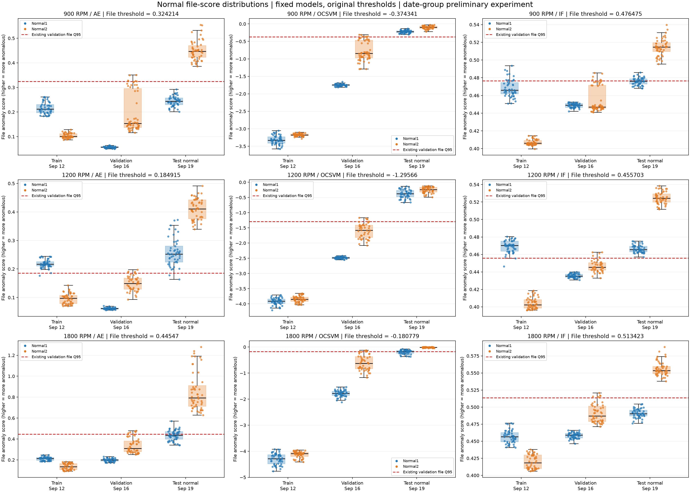

# 날짜 그룹 예비 실험 결과

실험일: 2026-11-06. 사용자 지정 날짜 분할로 AE·OCSVM·IF를 RPM별로 각각 학습·평가했습니다.
**실제 Run 경계를 확인한 독립 Run 실험이 아닙니다.** run_id는 빈칸이며 date_group만 기록했습니다. DAE는 실행하지 않았습니다.

## 분할과 사전 검사

- 2026-09-12 Normal1·Normal2: 학습
- 2026-09-16 Normal1·Normal2: 검증
- 2026-09-19 Normal1·Normal2: 정상 시험, 같은 날짜 결함 상태: 이상 시험
- Normal3와 품질 문제 파일 제외. 9/12·9/16의 결함 데이터도 사용하지 않음.
- 2,091개 사용 파일의 품질검사 SHA256 일치, 경로 중복 0, 내용 중복 0을 확인한 뒤 전처리·학습 시작.
- 전체 실제 Run 미확정 목록은 그대로 유지. 분할·모델·평가 결과에 date_preliminary/date_not_actual_run 표기.

| RPM | 학습 정상 | 검증 정상 | 시험 정상 | 시험 결함 |
| --- | ---: | ---: | ---: | ---: |
| 900 | 100 | 108 | 100 | 398 |
| 1200 | 102 | 94 | 99 | 393 |
| 1800 | 100 | 103 | 102 | 392 |

## 파일 단위 비교

파일 점수는 8구간 점수의 평균이며 임계값은 9/16 정상 검증 파일 점수의 Q95입니다.
AUPRC는 Average Precision(AP)입니다. 결과를 보고 설정·임계값을 조정하지 않았습니다.

| RPM | 모델 | 정상 오탐률 | 결함 탐지율 | AUROC | AUPRC(AP) |
| --- | --- | ---: | ---: | ---: | ---: |
| 900 | autoencoder | 51.00% | 75.13% | 0.8270 | 0.9590 |
| 900 | ocsvm | 100.00% | 98.74% | 0.7847 | 0.9507 |
| 900 | iforest | 71.00% | 77.39% | 0.7563 | 0.9425 |
| 1200 | autoencoder | 97.98% | 97.46% | 0.7950 | 0.9531 |
| 1200 | ocsvm | 100.00% | 100.00% | 0.7961 | 0.9537 |
| 1200 | iforest | 100.00% | 99.75% | 0.7835 | 0.9455 |
| 1800 | autoencoder | 74.51% | 91.58% | 0.8031 | 0.9488 |
| 1800 | ocsvm | 78.43% | 91.07% | 0.7981 | 0.9482 |
| 1800 | iforest | 50.98% | 72.96% | 0.7874 | 0.9441 |

## 해석 범위와 설정

- 날짜가 바뀐 정상 데이터에 대한 오탐률을 반드시 함께 봐야 합니다. 높은 탐지율이나 AP만으로 실사용 적합성을 주장하지 않습니다.
- 날짜 간 분포 차이 가능성은 있지만, 현재 지표만으로 원인을 단정하지 않습니다. 실제 Run 정보와 센서·운전 이력 확인이 필요합니다.
- 기본 전처리 CH3/8구간/Hann FFT/log1p/Train 기준 Z-score와 기존 모델 설정을 유지했습니다.
- AE: seed 42, batch 32, Adam 0.001, 최대 30 epoch, 검증 기준 최적 저장·patience 8.
- OCSVM: RBF, nu=0.05, gamma=scale. IF: 300 trees, random_state=42, n_jobs=1. 모두 정상 Train만 학습.
- 구간·파일 임계값은 각각 검증 Q95. 모델별 점수의 숫자 크기를 직접 비교하지 않습니다.
- stage_timings.json은 Python 프로세스 시작·파일 I/O 등을 포함하는 단계별 벽시계 시간이며 순수 모델 추론시간 비교가 아닙니다.
- 테스트 20개 통과 후 실행했으며, 완료 후 세 RPM의 실제 저장 정규화 기준이 9/12 Train 통계와 같고 OCSVM·IF의 두 임계값이 9/16 Validation Q95와 같은지 재확인했습니다. AE 최적 epoch은 세 RPM 모두 30입니다.

## 저장 위치와 재현

각 RPM 결과: `outputs/{RPM}rpm/date_prelim_20261106/`.
통합 CSV: `outputs/date_prelim_20261106_reports/` (파일·구간 비교, 상태별 판정 비율, 분할 수).
각 폴더에 preflight.json, split CSV/config, NPZ, AE 체크포인트·학습 이력, 모델별 결과, 실행 로그와 단계별 시간이 있습니다.
새 실험 폴더만 허용하며 같은 이름으로 전체 재실행하면 중단합니다. 재현 시 패키지 버전과 고정 설정을 확인하세요.

```powershell
python -m scripts.run_date_preliminary --run-name date_prelim_20261106_new
```

기본 Run 모드의 미확정 ID 차단은 유지합니다. 날짜 예비 실험은 명시적 별도 모드이며 실제 Run 확인을 대체하지 않습니다.

## 재학습 없는 정상 점수 분포 분석

기존 실험 파일 137개의 분석 전후 SHA256이 모두 같음을 확인했습니다.
모델·정규화 기준·임계값·기존 점수는 변경하지 않았습니다.
기존 CSV에 없는 AE 학습·검증 점수만 저장된 최적 모델의 추론으로 보완했고,
세 모델의 전체 점수를 저장 모델로 대조한 뒤 기존에 저장된 점수를 우선 사용했습니다.



각 패널에 학습(9/12)·검증(9/16)·시험 정상(9/19)을 함께 표시했습니다.
파랑은 Normal1, 주황은 Normal2, 빨간 점선은 **기존 파일 단위 검증 Q95**입니다.
박스는 사분위 범위와 중앙값, 점은 개별 파일입니다. 모델 간 y축 범위는 서로 다릅니다.
[개별 그래프와 상세 분석 보고서](../outputs/date_prelim_20261106_score_analysis/REPORT.md)도 저장했습니다.

### 점수·집계·임계값 확인

- AE는 입력과 복원값의 MSE, OCSVM·IF는 `-score_samples`이며 모두 값이 클수록 이상입니다. 음수인 OCSVM 점수도 더 큰 값이 이상입니다.
- 파일 점수는 0~7번 8개 구간 점수의 산술평균입니다. 세 모델의 저장 파일 점수와 재계산 평균의 최대 차이는 모두 0이었습니다.
- 세 모델 모두 정상 검증 **구간 점수의 Q95**와 **파일 평균 점수의 Q95**를 각각 올바르게 적용했습니다.
- Q95는 Normal1·Normal2를 합친 검증 집합에서 계산하며 상태별로 따로 정하지 않았습니다. 판정은 `score > threshold`입니다.
- 기존 파일 임계값을 넘은 검증 정상 수는 각 모델에서 900RPM 6/108, 1200RPM 5/94, 1800RPM 6/103입니다. 유한 표본의 Q95이므로 초과 비율이 정확히 5%일 필요는 없습니다.
- 검증 기준 Q95는 학습 정상이나 다른 날짜의 시험 정상까지 95% 정상 판정을 보장하지 않습니다.

### 파일 단위 오판정 개수

FP는 정상→이상, FN은 결함→정상입니다. TN은 정상→정상, TP는 결함→이상입니다.

| RPM | 모델 | FP | TN | FN | TP | 오판정 합계 FP+FN | Normal1 FP/파일 수 | Normal2 FP/파일 수 |
| --- | --- | ---: | ---: | ---: | ---: | ---: | ---: | ---: |
| 900 | AE | 51 | 49 | 99 | 299 | 150 | 0/49 | 51/51 |
| 900 | OCSVM | 100 | 0 | 5 | 393 | 105 | 49/49 | 51/51 |
| 900 | IF | 71 | 29 | 90 | 308 | 161 | 20/49 | 51/51 |
| 1200 | AE | 97 | 2 | 10 | 383 | 107 | 47/49 | 50/50 |
| 1200 | OCSVM | 99 | 0 | 0 | 393 | 99 | 49/49 | 50/50 |
| 1200 | IF | 99 | 0 | 1 | 392 | 100 | 49/49 | 50/50 |
| 1800 | AE | 76 | 26 | 33 | 359 | 109 | 24/50 | 52/52 |
| 1800 | OCSVM | 80 | 22 | 35 | 357 | 115 | 28/50 | 52/52 |
| 1800 | IF | 52 | 50 | 106 | 286 | 158 | 0/50 | 52/52 |

모든 RPM·모델에서 9/19 Normal2 시험 파일은 전부 이상으로 판정됐습니다.
900RPM AE의 오탐 51개는 모두 Normal2입니다. 점수 방향·집계·Q95 적용 불일치는 발견하지 못했습니다.
날짜와 정상 상태별 점수 차이는 관찰되지만, 운전·센서·정상 복구 등의 원인은 현재 자료만으로 단정하지 않습니다.

### AP 해석을 위한 시험 집합의 이상 파일 비율

| RPM | 정상 파일 | 이상 파일 | 전체 시험 파일 | 이상 파일 비율 |
| --- | ---: | ---: | ---: | ---: |
| 900 | 100 | 398 | 498 | 79.92% |
| 1200 | 99 | 393 | 492 | 79.88% |
| 1800 | 102 | 392 | 494 | 79.35% |

AP 약 0.95는 정확도 95%라는 뜻이 아닙니다. 이 시험 집합은 약 79~80%가 이상이므로 양성 비율을 함께 제시해야 합니다.
무작위 순위의 PR 기준선은 양성 비율 부근입니다. 유한 표본의 AP 기대값과 정확히 같다고 단정하지는 않습니다.
모두 이상으로 판정하면 탐지율은 100%지만 정상 오탐률도 100%이고 precision은 이상 파일 비율입니다.
AP는 여러 경계에서의 점수 순위 성능이고, 여기의 FP/FN은 기존 Q95 한 지점의 판정입니다.
따라서 높은 AP와 높은 정상 오탐률이 동시에 나타날 수 있으며, 오판정 합계만으로도 모델을 선정하지 않습니다.

분석 CSV·그래프·검증 내역은 `outputs/date_prelim_20261106_score_analysis/`에 보관했습니다.
이 분석을 근거로 임계값을 수정하거나 재학습하지 않았습니다.
