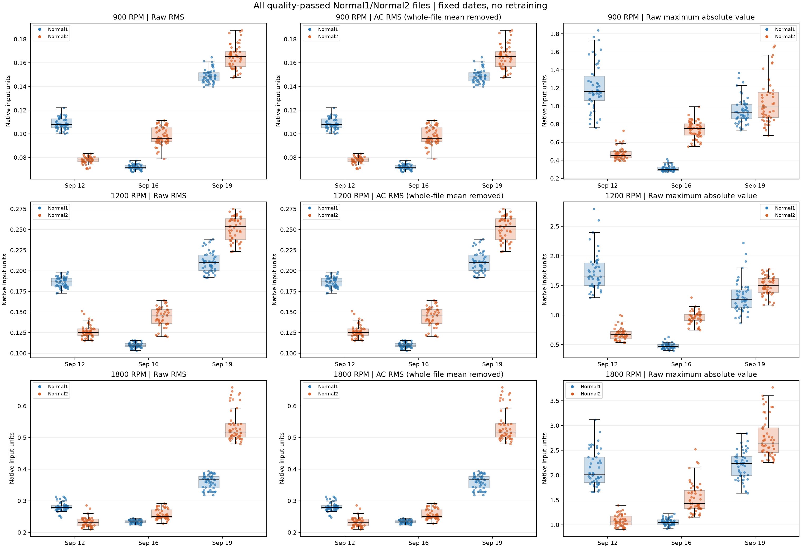
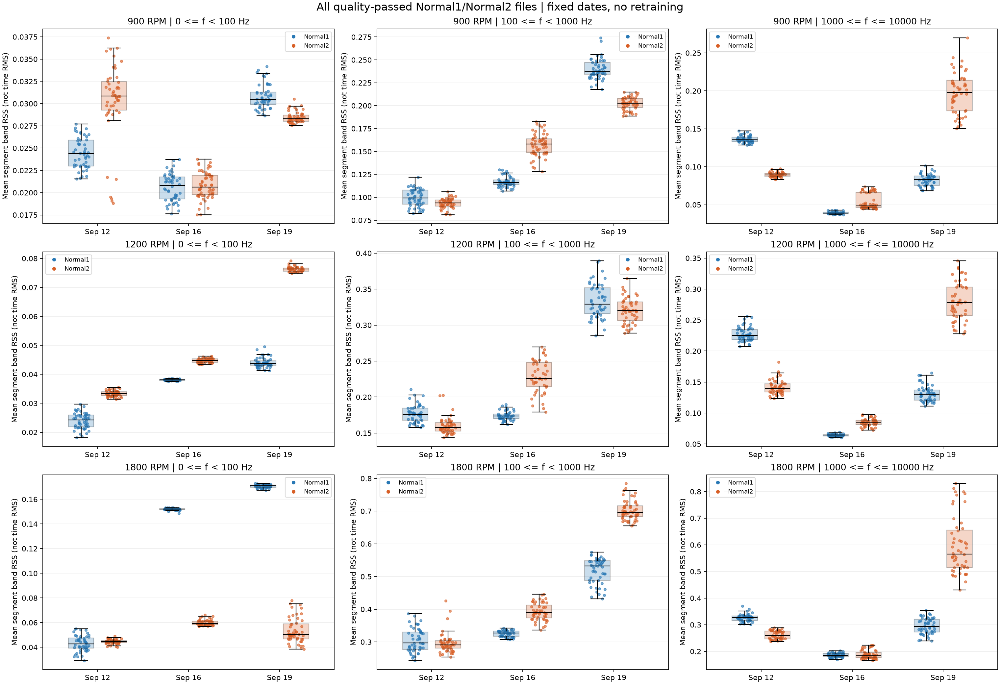
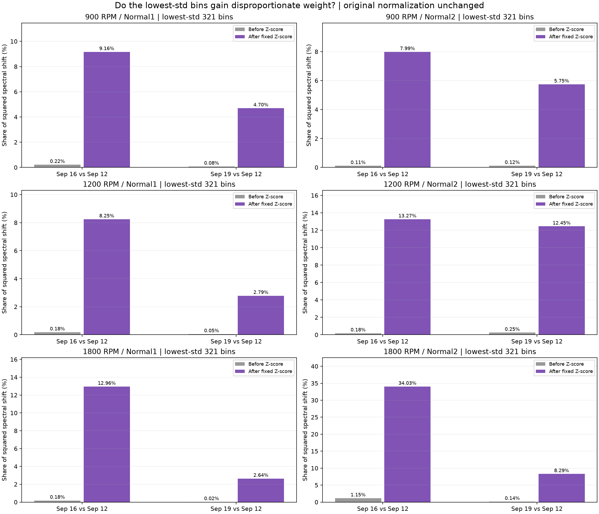

# 날짜별 정상 CH3 데이터 분석

기존 모델 재학습·임계값·정규화 기준 변경 없이 수행했습니다.
**정규화 전 원본에서도 날짜 차이가 확인됐으며, 작은 Train 표준편차가 일부 차이를 상대적으로 확대합니다. 다만 이 사실만으로 오탐 원인을 확정할 수는 없습니다.**

## 분석 범위와 원본 보존

- 9/12·9/16·9/19 × 900·1200·1800RPM의 Normal1·Normal2 원본 920개를 점검했습니다.
- 기존 품질검사 제외 12개는 사유를 따로 기록하고, 통과한 **908개 전체**의 통계를 사용했습니다. Normal3는 제외했습니다.
- 대표 파형은 각 날짜·RPM·상태에서 RMS 중앙값에 가장 가까운 파일입니다. 대표 파일만으로 결론을 내리지 않았습니다.
- 원본 920개와 기존 outputs 파일 187개의 분석 전후 SHA256이 모두 같았습니다. 모델·임계값 파일을 포함하여 기존 결과는 보존됐습니다.
- 원본에서 다시 계산한 908개 파일의 구간별 log1p 스펙트럼은 기존 실험의 정규화 전 NPZ와 정확히 일치했습니다.

## 1. 원본 파형·전체 파일 통계

각 점은 파일 하나이며 파랑은 Normal1, 주황은 Normal2입니다. 수치는 원본의 입력 단위로, 물리 단위·센서 교정은 확인되지 않았습니다.

**확인된 사실:** Normal2의 9/19 원본 RMS 중앙값은 9/12의 약 2.03~2.25배입니다.

| RPM | Normal2 RMS 9/12 | 9/16 | 9/19 | 9/19 ÷ 9/12 |
| --- | ---: | ---: | ---: | ---: |
| 900 | 0.077978 | 0.096249 | 0.165181 | 2.118배 |
| 1200 | 0.125263 | 0.145229 | 0.253820 | 2.026배 |
| 1800 | 0.230534 | 0.250744 | 0.517592 | 2.245배 |

Normal1의 9/19/9/12 RMS 중앙값 비율은 각각 1.375·1.124·1.313배입니다.
RMS와 전체 파일 평균을 제거한 AC RMS의 상대 차이는 모든 파일에서 최대 0.00154%로 작았습니다.
따라서 관찰된 RMS 차이를 단순한 DC 오프셋 차이만으로 설명하기는 어렵습니다.

원본 파형 예시 및 **전체 파일** 스펙트럼 중앙값·10~90백분위:

- [900RPM](../outputs/date_prelim_20261106_ch3_signal_analysis/figures/900_waveform_spectra.png)
- [1200RPM](../outputs/date_prelim_20261106_ch3_signal_analysis/figures/1200_waveform_spectra.png)
- [1800RPM](../outputs/date_prelim_20261106_ch3_signal_analysis/figures/1800_waveform_spectra.png)

파형은 회전 위상을 정렬하지 않았습니다. 그래프의 위상 차이를 결함 증거로 해석하지 않습니다.

## 2. 정규화 전 스펙트럼·대역별 차이

기존과 동일하게 CH3 → 8×8,192구간 → 구간 평균 제거 → Hann → 단측 FFT 진폭 보정을 적용했습니다.
선형 진폭과 **log1p 후/Z-score 전** 스펙트럼을 모두 비교했습니다.

대역은 [0,100), [100,1000), [1000,10000]Hz입니다.
대역 크기는 구간별 `sqrt(sum(진폭²))`의 8구간 평균(RSS)입니다. 시간 RMS나 PSD 적분이 아니며 같은 대역의 날짜 차이를 비교합니다.

| RPM | Normal2 중주파 RSS 9/19÷9/12 | Normal2 고주파 RSS 9/19÷9/12 |
| --- | ---: | ---: |
| 900 | 2.159배 | 2.214배 |
| 1200 | 2.032배 | 1.994배 |
| 1800 | 2.388배 | 2.187배 |

Normal1은 중주파가 1.79~2.39배인 반면 고주파는 0.58~0.90배입니다.
따라서 날짜 차이는 정규화 이후에만 생긴 현상이 아니며, 일부 상태에서는 주파수 대역 구성도 달라졌습니다.
이것이 센서 이득·운전 조건·기계 상태 중 무엇 때문인지는 아직 확인하지 못했습니다.

## 3. 작은 Train 표준편차의 확대 효과

9/12 Train에서 저장한 σ와 평균을 그대로 사용했습니다. σ의 하한 1e-6이 실제로 적용된 주파수 bin은 세 RPM 모두 **0개**였습니다.
σ는 9/12 Normal1·Normal2 전체 Train에서 구한 기존 기준이며 상태별로 새로 계산하지 않았습니다.
각 Normal 상태의 날짜별 파일 평균 log1p 스펙트럼 중앙값과 9/12 중앙값의 차이 Δ를 구하고, 정규화 후 차이 Δ/σ를 비교했습니다.
작은 σ는 하위 10% 순위의 321개 bin으로 정의했습니다.

다음은 **Normal2의 9/19 대 9/12 중앙값 스펙트럼 차이** 중 작은 σ bin이 차지하는 제곱차 비율입니다.

| RPM | 정규화 전 기여도 | 고정 정규화 후 기여도 |
| --- | ---: | ---: |
| 900 | 0.12% | 5.75% |
| 1200 | 0.25% | 12.45% |
| 1800 | 0.14% | 8.29% |

**관찰:** 작은 σ가 상대적인 차이 비중을 높이는 것은 확인됩니다. 그러나 이 지표에서 9/19 Normal2 차이의 대부분은 나머지 bin에도 남습니다.
이는 중앙값 스펙트럼의 **입력 차이 분해**이며 모델별 이상점수·AE 복원오차의 기여도 분석이 아닙니다.
작은 σ가 오탐의 주원인인지 또는 유일한 원인인지는 이 결과로 확정할 수 없습니다.
[주파수별 σ·정규화 전후 Δ 그래프](../outputs/date_prelim_20261106_ch3_signal_analysis/figures/normalization_diagnostics.png)와 전체 날짜별 수치는 상세 보고서에 있습니다.

## 4. 결론과 미확인 사항

**사실:** 원본 진동 크기와 주파수별 분포가 날짜에 따라 다르고, 특히 9/19 Normal2는 RMS·중고주파 크기가 높습니다.
작은 σ의 상대적 확대 효과도 있지만 정규화 하한이 적용된 사례는 없습니다. 전처리 재계산과 기존 입력 간 불일치는 발견하지 못했습니다.

**원인 후보이며 미확인:** 센서 위치·감도·단위·이득, 장착·재조립, 베어링 교체, 실제 RPM, 결함 실험 후 정상 복구 상태.
실제 Run 정보와 취득 이력을 확인하기 전에는 물리적 결함·센서 문제·정규화 문제 중 하나로 단정하지 않습니다.
파일들은 연속 측정으로 상관될 수 있으므로 전체 파일 통계가 곧 독립 Run에 대한 통계 검정을 뜻하지는 않습니다.

기존 시험 결과를 이용해 설정을 사후 조정하지 않았습니다.
전체 파일 CSV, 그룹 통계, 제외 목록, 대표 파일 선택 근거와 SHA256 기록은
[상세 보고서](../outputs/date_prelim_20261106_ch3_signal_analysis/REPORT.md)와 같은 폴더에 보관했습니다.
