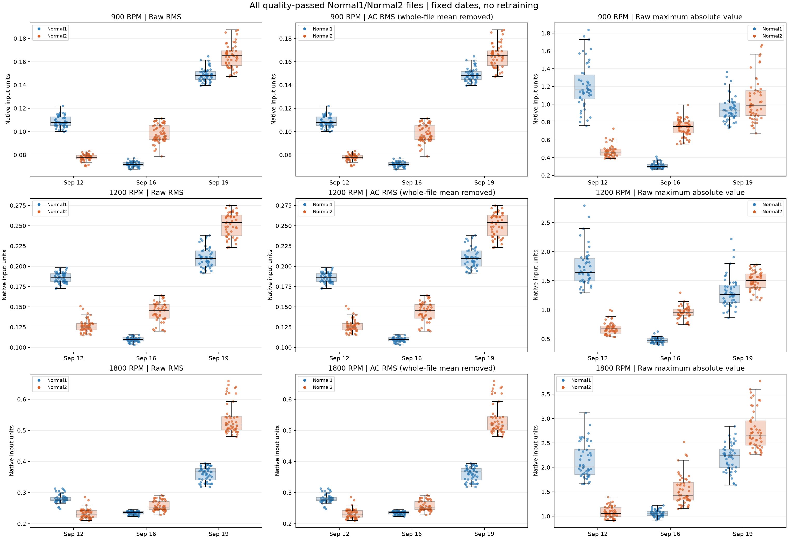
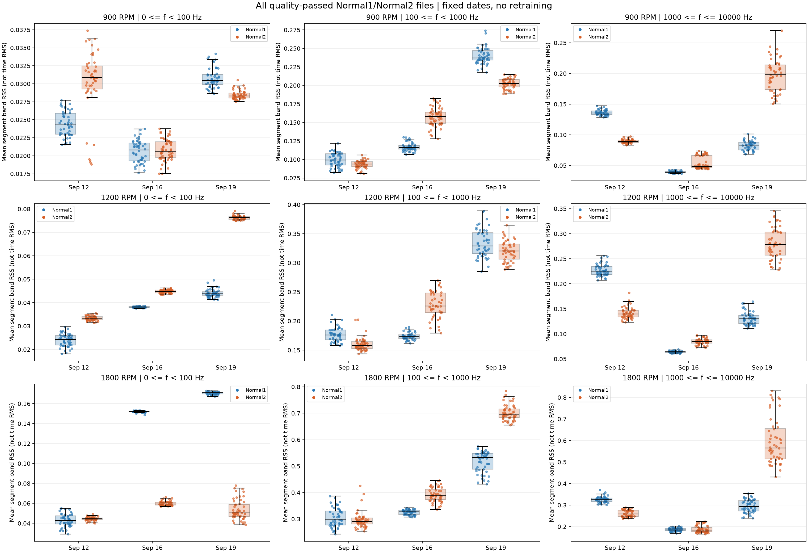
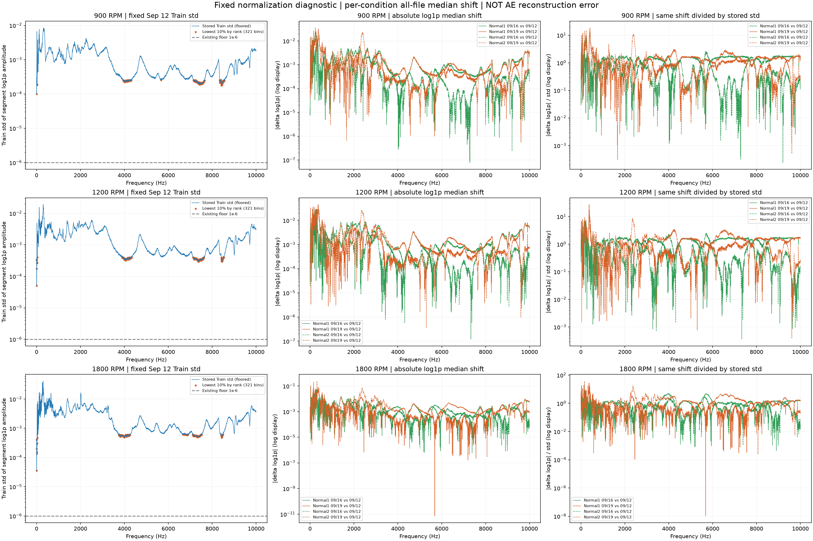
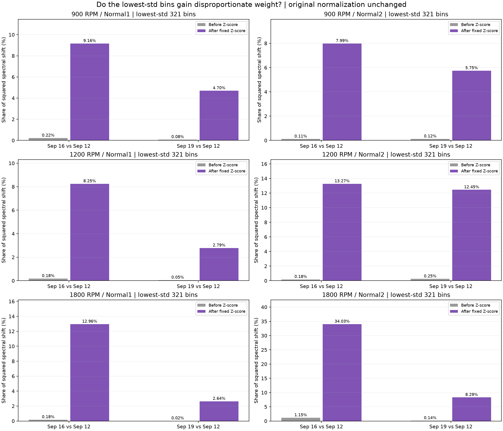

# 날짜별 정상 CH3 원본 및 정규화 확대 분석

기존 모델 재학습·임계값 변경 없이 원본 CH3와 기존 9/12 Train 정규화 기준을 분석했습니다.
원본 Normal1·Normal2 920개를 목록으로 점검하고, 기존 품질 정책에 따라 12개를 제외한 908개 전체를 통계에 사용했습니다. Normal3는 범위에서 제외했습니다.
제외 파일은 각 RPM excluded.csv에 기록했습니다. 일부 CH3만 유효하더라도 기존 전체 6채널 품질 정책을 유지했습니다.

## 방법과 그림

- 원본 파형: CH3의 65,536샘플(2.56초), 입력 수치의 단위를 그대로 사용합니다. 물리 단위·교정은 확인되지 않았습니다.
- 파일 RMS·최대 절댓값·평균(DC)·평균 제거 RMS를 계산했습니다. 모든 분포 점은 개별 파일입니다.
- 스펙트럼: 기존과 동일한 8×8,192구간, 구간 평균 제거, Hann, 단측 FFT 진폭 보정, 0~10kHz. 파일은 8구간 평균으로 요약합니다.
- 선형 진폭과 log1p 후/Z-score 전 스펙트럼을 모두 저장했습니다. 기존 pre-Z NPZ와 파일별 8구간 스펙트럼이 정확히 일치함을 확인했습니다.
- 대역: [0,100), [100,1000), [1000,10000]Hz. 대역 크기는 구간별 sqrt(sum(진폭²))의 8구간 평균(RSS)이며 PSD 적분이나 시간 RMS가 아닙니다. 폭이 다른 대역끼리 절대 크기를 비교하지 않습니다.
- 스펙트럼 선은 전체 파일의 주파수별 중앙값, 음영은 10~90백분위입니다. 파형 예시는 각 날짜·상태에서 RMS 중앙값에 가장 가까운 파일이며 원인 결론의 근거로 단독 사용하지 않습니다.

각 RPM의 원본 파형·전체/저주파 진폭·pre-Z log1p 비교:
- [900RPM 파형 및 스펙트럼](figures/900_waveform_spectra.png)
- [1200RPM 파형 및 스펙트럼](figures/1200_waveform_spectra.png)
- [1800RPM 파형 및 스펙트럼](figures/1800_waveform_spectra.png)

## 전체 파일 RMS 중앙값

| RPM | 상태 | 9/12 | 9/16 | 9/19 | 9/19 ÷ 9/12 |
| --- | --- | ---: | ---: | ---: | ---: |
| 900 | Normal1 | 0.107702 | 0.0717759 | 0.148138 | 1.375 |
| 900 | Normal2 | 0.0779778 | 0.0962495 | 0.165181 | 2.118 |
| 1200 | Normal1 | 0.186594 | 0.109768 | 0.209654 | 1.124 |
| 1200 | Normal2 | 0.125263 | 0.145229 | 0.25382 | 2.026 |
| 1800 | Normal1 | 0.278929 | 0.235871 | 0.366146 | 1.313 |
| 1800 | Normal2 | 0.230534 | 0.250744 | 0.517592 | 2.245 |

## 작은 Train 표준편차의 확대 효과

기존 정규화 기준은 변경하지 않았습니다. 주파수별 실제 사용 σ=max(Train std,1e-6)를 사용합니다.
각 상태의 9/12 파일 평균 log1p 스펙트럼 중앙값을 기준으로 날짜별 차이 Δ를 구하고, 동일 차이가 정규화 후 Δ/σ가 되는지 분석합니다.
σ가 작은 하위 10% 순위 321개 bin을 고정 선택했습니다. 표의 기여도는 이 bin이 전체 주파수의 제곱차 합에서 차지하는 비율이며 물리적 진동 에너지가 아닙니다.
정규화 전/후 기여도가 커지는지로 작은 σ가 특정 날짜 차이를 상대적으로 강조하는지 확인합니다. 단순히 1/σ가 크다는 사실만으로 주원인이라고 결론 내리지 않습니다.

| RPM | 상태 | 비교 날짜 | Δ log1p RMS | Δ/σ RMS | 작은 σ bin 기여: 전 | 후 |
| --- | --- | --- | ---: | ---: | ---: | ---: |
| 900 | Normal1 | 09/16 | 0.00191825 | 1.336 | 0.22% | 9.16% |
| 900 | Normal1 | 09/19 | 0.00289807 | 1.683 | 0.08% | 4.70% |
| 900 | Normal2 | 09/16 | 0.00197591 | 1.079 | 0.11% | 7.99% |
| 900 | Normal2 | 09/19 | 0.00314507 | 1.916 | 0.12% | 5.75% |
| 1200 | Normal1 | 09/16 | 0.00302897 | 1.302 | 0.18% | 8.25% |
| 1200 | Normal1 | 09/19 | 0.00411964 | 1.649 | 0.05% | 2.79% |
| 1200 | Normal2 | 09/16 | 0.00278025 | 0.934 | 0.18% | 13.27% |
| 1200 | Normal2 | 09/19 | 0.00439946 | 1.746 | 0.25% | 12.45% |
| 1800 | Normal1 | 09/16 | 0.0048933 | 1.139 | 0.18% | 12.96% |
| 1800 | Normal1 | 09/19 | 0.00656577 | 1.695 | 0.02% | 2.64% |
| 1800 | Normal2 | 09/16 | 0.00415745 | 1.388 | 1.15% | 34.03% |
| 1800 | Normal2 | 09/19 | 0.0107319 | 2.477 | 0.14% | 8.29% |

| RPM | 사용 σ 최소 | 중앙값 | 하한 적용 bin | 하위10% σ 상한 |
| --- | ---: | ---: | ---: | ---: |
| 900 | 0.000100488 | 0.000649608 | 0 | 0.00025534 |
| 1200 | 5.02115e-05 | 0.00108744 | 0 | 0.000402636 |
| 1800 | 3.5801e-05 | 0.00162026 | 0 | 0.000607991 |

## 관찰 사실과 원인 추정의 구분

위 표와 그래프는 전체 파일의 관찰 통계입니다. RMS·대역 크기·주파수별 차이는 센서 교정이나 실제 운전 조건이 같은지를 증명하지 않습니다.
Δ/σ와 normalized_input_msd는 입력의 표준화 편차이며 AE 복원오차가 아닙니다. 이 분석만으로 작은 σ가 이전 오탐의 원인 또는 유일한 원인이라고 확정할 수 없습니다.
센서 위치·감도·단위·측정 이득, 장착/재조립·베어링 교체, 실제 RPM과 정상 복구 여부가 확인되지 않았습니다. 이들은 원인 후보일 뿐 현재 확인된 사실이 아닙니다.
파형은 각 파일의 시작 시각을 0으로 둔 것으로 회전 위상을 동기화하지 않았습니다. 날짜별 위상 차이를 결함 증거로 해석하지 않습니다.
실제 Run 경계는 여전히 미확정입니다. 분석 결과를 보고 기존 전처리 기준·임계값을 바꾸거나 모델을 재학습하지 않았습니다.

## 산출물

file_metrics/group_statistics CSV: 전체 파일과 날짜·RPM·상태별 분포. file_profiles NPZ: 파일 평균 진폭·log1p 스펙트럼.
normalization_shift/frequency_std CSV: 작은 σ와 날짜 차이의 정량 분석. representatives JSON: 예시 파일 선택 근거.
preservation.json: 원본 정상 MAT와 기존 outputs 산출물의 분석 전후 SHA256 확인. 실제 원본이나 기존 실험 파일에는 쓰지 않았습니다.
