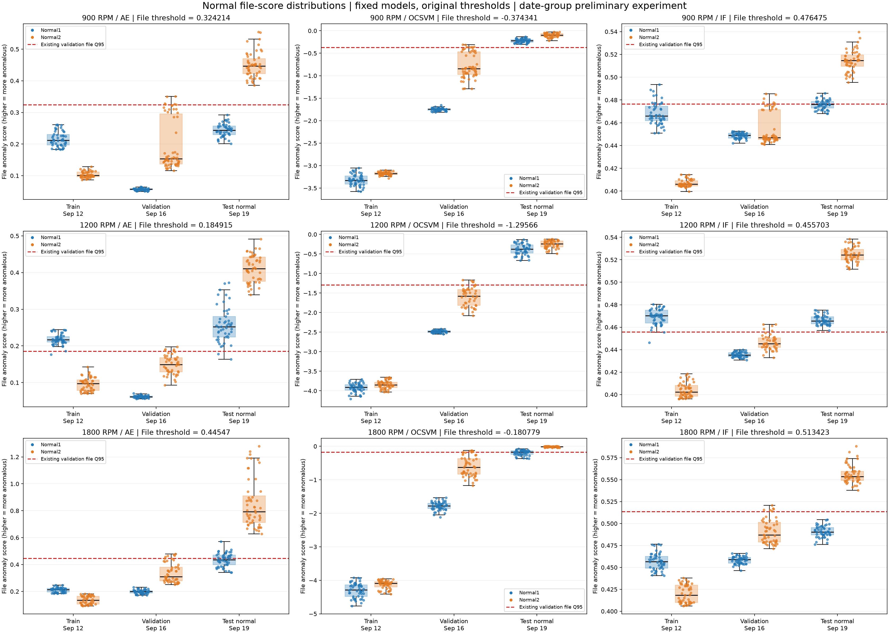

# 날짜 예비 실험 정상 점수 분포 분석

기존 실험 보존·재학습 없음. 저장 모델로 점수만 확인하고 기존 임계값을 그대로 사용했습니다.
기존 CSV에 없는 AE Train/Validation 점수는 저장된 최적 체크포인트의 추론으로 보완했습니다.
AE 시험 및 OCSVM·IF 점수는 재계산값과 일치 여부를 확인한 뒤 원래 저장된 점수를 분석에 사용했습니다.

## 그래프

각 그래프는 파일 점수 기준입니다. x축은 학습(9/12)·검증(9/16)·시험 정상(9/19), 색은 Normal1·Normal2입니다.
박스는 중앙값·사분위 범위, 점은 개별 파일입니다. 빨간 점선은 두 정상 상태를 합친 기존 검증 파일 Q95입니다.
모든 y축은 원래 점수이고 위쪽일수록 이상입니다. 음수인 OCSVM 점수도 부호를 다시 바꾸지 않았습니다.
모델·RPM 사이 y축 범위는 독립이므로 점수의 크기를 직접 비교하지 않습니다.

## 확인 결과

- AE: double 정밀도 제곱 복원오차의 채널·주파수 평균(MSE), 비음수이며 클수록 이상.
- OCSVM·IF: sklearn score_samples의 음수. 원점수·저장 점수와 대조했으며 클수록 이상.
- 파일별 8개 구간(0~7)을 산술평균한 값이 원래 파일 CSV와 일치.
- 세 모델 모두 구간은 검증 구간 Q95, 파일은 검증 파일 평균 점수 Q95와 일치. 검증 집합은 Normal1·Normal2 합산.
- 판정은 score > threshold. 재학습·최적화·임계값 변경 없음.
- 허용 오차 rtol=1e-7, atol=1e-10으로 저장 점수/Q95를 대조했으며 실제 차이는 verification.csv에 기록.

## 시험 파일 오판정 개수

FP: 정상→이상, FN: 결함→정상. Normal1·Normal2 열은 FP/해당 정상 파일 수입니다.

| RPM | 모델 | FP | TN | FN | TP | 오판정 합계 | Normal1 FP/수 | Normal2 FP/수 |
| --- | --- | ---: | ---: | ---: | ---: | ---: | ---: | ---: |
| 900 | autoencoder | 51 | 49 | 99 | 299 | 150 | 0/49 | 51/51 |
| 900 | ocsvm | 100 | 0 | 5 | 393 | 105 | 49/49 | 51/51 |
| 900 | iforest | 71 | 29 | 90 | 308 | 161 | 20/49 | 51/51 |
| 1200 | autoencoder | 97 | 2 | 10 | 383 | 107 | 47/49 | 50/50 |
| 1200 | ocsvm | 99 | 0 | 0 | 393 | 99 | 49/49 | 50/50 |
| 1200 | iforest | 99 | 0 | 1 | 392 | 100 | 49/49 | 50/50 |
| 1800 | autoencoder | 76 | 26 | 33 | 359 | 109 | 24/50 | 52/52 |
| 1800 | ocsvm | 80 | 22 | 35 | 357 | 115 | 28/50 | 52/52 |
| 1800 | iforest | 52 | 50 | 106 | 286 | 158 | 0/50 | 52/52 |

## AP 해석에 필요한 이상 파일 비율

| RPM | 시험 정상 | 시험 이상 | 시험 전체 | 이상 파일 비율 |
| --- | ---: | ---: | ---: | ---: |
| 900 | 100 | 398 | 498 | 79.92% |
| 1200 | 99 | 393 | 492 | 79.88% |
| 1800 | 102 | 392 | 494 | 79.35% |

AUPRC는 Average Precision(AP)입니다. AP 0.95를 정확도 95%로 해석하지 않습니다.
시험 집합은 약 79~80%가 이상 파일이므로 AP를 볼 때 양성 비율을 함께 제시합니다.
무작위 순위 PR 기준선은 양성 비율 부근이며 유한 표본 AP의 기대값과 정확히 동일하다는 뜻은 아닙니다.
전부 이상으로 판정하면 recall은 100%지만 precision은 이상 파일 비율이고 정상 오탐률은 100%입니다.
AP는 여러 점수 경계에서의 순위 성능, 현재 FP/FN은 기존 Q95 한 지점의 판정입니다. 높은 AP와 높은 오탐률은 동시에 나타날 수 있습니다.

## 관찰과 한계

모든 RPM·모델에서 9/19 Normal2 시험 파일은 전부 이상으로 판정됐습니다.
900RPM AE의 정상 오탐 51개는 모두 Normal2이며 Normal1 오탐은 0개입니다.
점수 방향·파일 평균·Q95 적용에서 불일치는 발견하지 못했습니다. 정상 상태와 날짜별 점수 차이를 추가로 확인할 필요가 있습니다.
다만 측정일·운전 조건·센서·정상 복구 여부 중 어느 것이 원인인지 이 분석만으로 확정할 수 없습니다.
시험 결과를 보고 임계값을 올리거나 모델을 재학습하지 않았습니다. 독립 Run 확인과 별개의 날짜 그룹 예비 분석입니다.

## 산출물

- normal_scores_overview.png 및 figures/{RPM}_{model}.png: 전체·개별 그래프
- *_file_scores.csv: 분석에 사용한 학습·검증·시험 파일 점수
- normal_distribution_summary.csv: 정상 상태별/합산 분포 통계와 임계값 초과 수
- confusion_counts.csv: FP/TN/FN/TP·AP·이상 파일 비율
- verification.csv: 점수·집계·두 단위 Q95 대조 결과
- preservation.json: 분석 전후 기존 실험 산출물 SHA256 비교
